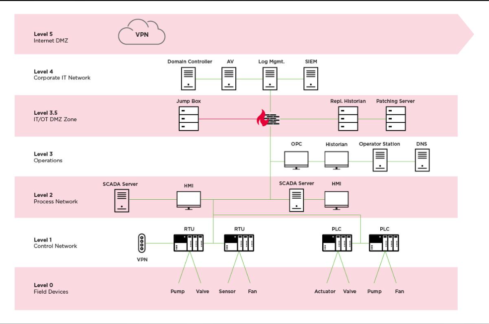
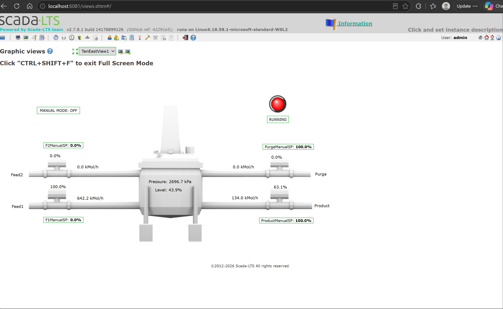
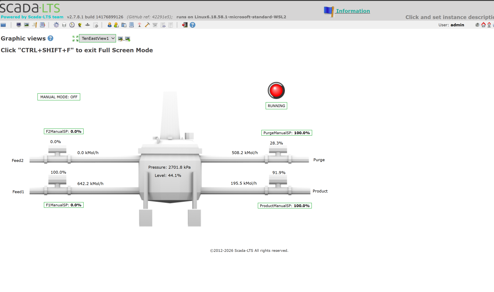
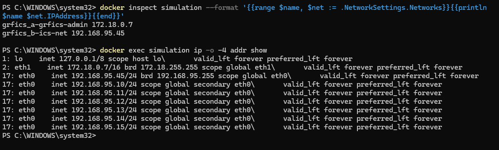
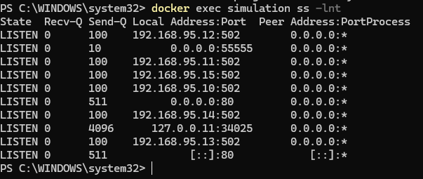

# Phase 1 — Establishing the OT Operational Baseline

**Project 001 · GRFICSv3 Chemical Plant Assessment**  
**Observation window:** November 18–21, 2026 (plus earlier November 7 connectivity observations)  
**Method:** Read-only asset discovery, HMI observation, PLC inspection and network verification  
**Status:** Operational/transport baseline documented; Modbus payload analysis **not yet performed**

> **Engineering question:** Before analyzing threats or making changes, can I explain what is running, which systems communicate, how the field devices are hosted, and which conclusions are supported by evidence?

## The result in 30 seconds

| Question | Observed answer |
|---|---|
| Is the plant accessible? | Seven GRFICS containers reported healthy; the plant visualization loaded and SCADA-LTS displayed changing values. |
| Is OpenPLC operating? | The `Chemical Reactor` program reported **Running**, although its early logs showed device connection refusals. |
| Where are the six field devices? | Six configured Modbus TCP IP endpoints are **secondary addresses on one simulation container**, not six independently verified hosts. |
| Can the PLC reach their TCP services? | All six addresses had port-502 listeners, and a subsequent snapshot showed **six ESTABLISHED TCP sessions** from the PLC. |
| Was Modbus application behavior proven? | **Not yet.** Established TCP sessions do not prove valid register data or effective security controls. |

**Principal finding:** What initially appeared to be six separate field devices is represented by **six logical Modbus endpoints hosted within one simulation container**. The investigation moved from *configuration → IP ownership → listening ports → active TCP sessions*.

## 1. Understand the environment

This project assesses an isolated chemical reactor simulation with a SCADA-LTS HMI, OpenPLC controller, engineering workstation, and security testing/monitoring components. Management and ICS Docker networks connect components; additional paths and policy enforcement remain to be verified.

*Figure 1 — Conceptual high-level architecture. This illustrates the assessed environment, not proof that every line shown is an observed flow or an enforced boundary.*

**Operating constraint:** The baseline was collected without intentionally changing PLC logic, process setpoints, valve positions, or field-device configurations.

## 2. Establish a process baseline

GRFICS reported **Simulation running**; SCADA-LTS displayed **RUNNING** and **Manual Mode: OFF**. Two observations showed changes in the HMI's process values:

| HMI indicator | Initial (T0) | Later (T1) |
|---|---:|---:|
| Reactor pressure | 2696.7 kPa | 2701.8 kPa |
| Reactor level | 43.9% | 44.1% |
| Product flow | 134.0 kmol/h | 195.5 kmol/h |
| Purge flow | 0.0 kmol/h | 508.2 kmol/h |
| Product indicated valve position | 63.1% | 91.9% |
| Purge indicated valve position | 0.0% | 28.3% |

| Initial HMI screenshot | Later HMI screenshot |
|---|---|
|  |  |

*Figures 2–3 — Both source screenshots are committed. Their capture timestamps are not visible, so the precise interval cannot be independently confirmed. Changing displayed values do not by themselves validate measurement accuracy or the controller-to-simulation data path.*

## 3. Investigate before assuming an incident

The initial OpenPLC runtime log contained **Connection refused** entries for several simulated devices. Rather than label these messages a persistent outage or malicious activity, I considered a startup-order hypothesis: a controller can be running before its downstream services are available.

A later runtime excerpt included **Connected to MB device Analyzer** and Modbus client acceptance. That demonstrated some connection activity, but left a question: *where are the six configured device IP addresses, and do they actually accept PLC connections?*

This is the same distinction required in industrial troubleshooting: a running controller is not proof that everything downstream is healthy, and an error message is not proof of a cyberattack.

## 4. Discover the actual device architecture

OpenPLC listed six **Generic Modbus TCP Devices**, each configured for port **502** and Unit ID **247**.

| Simulated device | Configured target | OpenPLC input words | Output word |
|---|---|---|---|
| Feed 1 | `192.168.95.10:502` | `%IW100–101` | `%QW100` |
| Feed 2 | `192.168.95.11:502` | `%IW102–103` | `%QW101` |
| Purge | `192.168.95.12:502` | `%IW104–105` | `%QW102` |
| Product | `192.168.95.13:502` | `%IW106–107` | `%QW103` |
| Tank | `192.168.95.14:502` | `%IW108–109` | `%QW104` |
| Analyzer | `192.168.95.15:502` | `%IW110–112` | `%QW105` |

**Notable difference:** Analyzer has **three** configured input words; the others each have two. The addresses above are OpenPLC I/O memory allocations, not yet verified Modbus packet register offsets.

Docker inspection placed OpenPLC at **`192.168.95.2`** and the chemical-process simulation at **`192.168.95.45`** on the shared ICS network. A closer inspection inside the simulation container identified all six configured device addresses as **secondary IPv4 aliases on `eth0`**.

*Figure 4 — The six simulated Modbus device addresses belong to one container interface. This discovery corrects an initial assumption that each address might represent a separately containerized device.*

## 5. Validate the connection chain

Instead of stopping at the configuration screen, I checked successive levels of network evidence:

| Verification step | Observation | What it establishes |
|---|---|---|
| **Configuration** | Six Modbus destinations in OpenPLC | Intended endpoint mapping |
| **Address ownership** | All six addresses on simulation `eth0` | Where logical endpoints are hosted |
| **Socket state** | `ss -lnt`: six `LISTEN` sockets on TCP 502 | Services listening on each configured target |
| **Active sessions** | `ss -tn`: six `ESTAB` sessions from `192.168.95.2` to the six targets | PLC-to-endpoint TCP sessions established at observation time |

*Figure 5 — Listener evidence for each configured target.*

The most recent `ss -tn` screenshot in the working session showed connections from the PLC at **`192.168.95.2`** to **`192.168.95.10–15:502`**, each in **ESTAB** state. **That screenshot has not yet been committed to GitHub**, so the claim is transcribed from the session observation pending publication of its original capture.

**Assessment:** The six targets are configured, assigned, listening, and had established TCP sessions. We have **not** yet proven the validity of Modbus function codes, register data, or application responses.

## Engineering conclusions and boundaries

| Verified during Phase 1 | Not claimed |
|---|---|
| Seven-container lab available and HMI displayed changing values | Production-level reliability or accuracy |
| PLC runtime reported running, with historical connection errors | A confirmed attack or fully diagnosed root cause |
| Six logical device IPs live within one simulation container | Six separate physical devices / independent containers |
| Six listeners and six established TCP connections observed | Successful or secure Modbus application transactions |
| PLC and simulation share an ICS Docker network | Tested segmentation, ACLs or protective controls |

**Why it matters:** A meaningful OT assessment begins with a defensible understanding of *what exists, what is communicating, and what the evidence actually proves*. This baseline supports future security analysis while minimizing disruption to an industrial process—even when that process is simulated.

## Next chapter

**Phase 2 — Network architecture:** Verify the remaining interfaces, intended data flows, access boundaries and routing; refine our original topology.  
**Phase 3 — Industrial protocol analysis:** Use Wireshark/PCAP evidence to evaluate Modbus functions, register interactions, patterns and anomalies.  
**Later network design:** Model proposed segmentation and controls in Cisco Packet Tracer—separate from the Docker lab's observed implementation.

### Supporting technical evidence (optional)

The case study above is intentionally readable **without** clicking through individual screenshots. For engineers who want to audit or reproduce the work:

<strong>Expand the technical appendix</strong>

- [Complete evidence index and original screenshots E01–E16](evidence/README.md)
- [Six-device Modbus register and endpoint inventory](modbus-endpoint-inventory.md)
- [Observed network interfaces and targets (CSV)](network-inventory.csv)
- [Test record with failures, caveats and results (CSV)](test-results.csv)
- [Original operational collection runbook](technical-runbook.md)

**Scope:** Simulated GRFICSv3 lab, observations made November 7–21, 2026. No employer production devices or networks were investigated.
