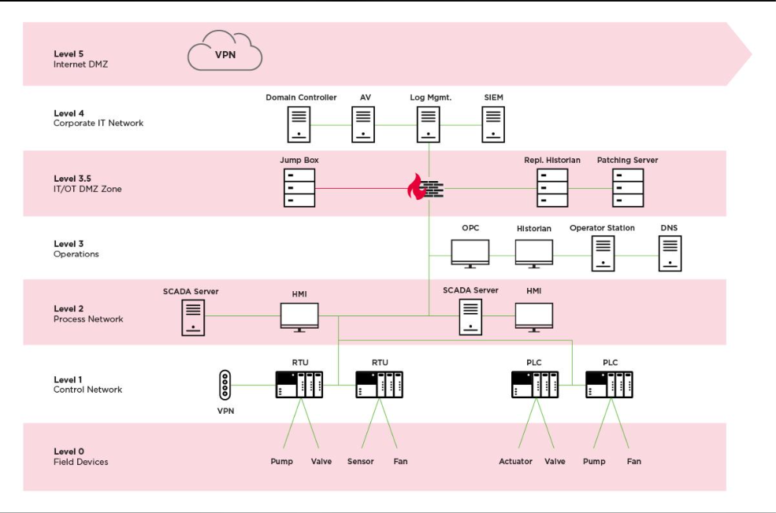

# Project 001 — OT Security Architecture & Defense Lab

## The scenario

You are assigned to assess a **simulated industrial chemical plant** that relies on a controller, SCADA/HMI, engineering workstation, field-device simulation, and interconnected networks to operate a reactor.

Your engineering task is to **establish normal operation, understand how components communicate, identify security and availability risks, design and validate defensive controls, and investigate suspicious behavior without unnecessarily disrupting the process**. Every conclusion must follow from reproducible tests and evidence.

### The environment at a glance

*Figure 1 — Initial GRFICSv3 lab topology. Conceptual illustration based on a partially verified asset inventory; not all pictured paths and network memberships have been confirmed. We will refine this same design when we reach network engineering and Cisco Packet Tracer.*

**Status:** Phase 1 — baseline verification in progress. This is an isolated personal lab, not a production security assessment.

## Find the skills relevant to your role

| What you're evaluating | Go directly to | Evidence status |
|---|---|---|
| **OT / ICS security engineering** | [Plant baseline and HMI investigation](01-baseline/README.md) · [Architecture & trust boundaries](02-architecture/README.md) | Baseline partly observed; architecture work ahead |
| **SOC analyst / incident response** | **[SOC investigation & detection](05-detection-response/README.md)** | A prior DNS investigation is documented; *chemical-plant detection* is planned |
| **Network / security engineering** | [Network inventory](01-baseline/network-inventory.csv) · [Industrial traffic analysis](03-protocol-analysis/README.md) | Network memberships observed; protocol capture pending |
| **Risk / project management** | [Charter](00-governance/project-charter.md) · [Risk register](00-governance/risk-register.csv) · [Decision log](00-governance/decision-log.md) | Living project documents published |
| **Certification-aligned practical tests** | [GICSP, GRID & PMI-RMP objective-to-evidence map](00-governance/objectives-traceability.md) | Select objectives mapped; completion tracked honestly |

## The single project story

**Assess → Understand → Protect → Detect → Respond → Validate.**

1. **Baseline:** What assets exist? Is the HMI and process accessible? What is verified versus assumed?
2. **Architecture:** What are the actual network zones, systems, routes, and intended communication paths?
3. **Protocol evidence:** What packets are exchanged? Which industrial protocols and values are actually observed?
4. **Defense:** What security control can be implemented without impairing process availability?
5. **Detection & response:** What would distinguish a process/network failure from suspicious behavior?
6. **Risk:** What changed, what remains uncertain, and what is the residual operational impact?
7. **Report:** Can another engineer reproduce the result from the evidence?

Each phase is **a chapter in the same plant assessment**, not an unrelated portfolio project.

## Verified work so far

During sessions on **November 7 and November 18, 2026**, seven GRFICSv3 containers were inventoried. The simulation loaded, SCADA-LTS displayed changing reactor values, and OpenPLC reported a running Chemical Reactor program. The PLC runtime log excerpt included device connection refusals; whether they were startup-only or ongoing still needs investigation. A previous HMI web-access timeout was recovered by restarting the affected HMI container, without proving its underlying root cause.

- [Four verified screenshots and supporting observations](01-baseline/evidence/README.md)
- [HMI baseline T0 vs. T1 comparison](01-baseline/evidence/E03-E04-20261118-hmi-comparison.md)
- [OpenPLC runtime observation and unresolved connection findings](01-baseline/evidence/E05-20261118-plc-runtime-observation.md)
- [Phase 1 tests and next verification steps](01-baseline/README.md)

**Not yet proven:** Complete controller-to-process communication paths, specific industrial packet exchanges, implemented segmentation controls, or chemical-plant detection rules. The initial topology is a learning-oriented map to be validated, not a security assessment result.

## Evidence and integrity

Reports distinguish **observed facts**, **hypotheses**, **validated results**, and **planned tests**. Supporting SOC coursework is clearly marked as an *earlier separate training scenario*; it is not misrepresented as a chemical-plant security incident. Only isolated, sanitized lab evidence will be published. No employer systems, credentials or production data are used.

**Document owner:** Christopher Spencer · CySA+ · Industrial maintenance / cybersecurity · B.S. Cybersecurity in progress
